<div align="center">

МИНИСТЕРСТВО НАУКИ И ВЫСШЕГО ОБРАЗОВАНИЯ РОССИЙСКОЙ ФЕДЕРАЦИИ

Федеральное государственное автономное образовательное учреждение высшего образования

**«Национальный исследовательский технологический университет «МИСИС»**

Институт компьютерных наук (ИКН)

Кафедра автоматизированных систем управления (АСУ)

<br>

## ОТЧЕТ

по лабораторной работе

на тему

**«Бенчмарк форматов хранения и кодеков сжатия в локальном Lakehouse
на примере запроса TPC-H Q16 «Parts/Supplier Relationship» (вариант 4)»**

</div>

<br>

<div align="right">

Выполнил:<br>
студент группы БИВТ-24-6,<br>
Афанасьева Арина Владимировна

Проверил:<br>
преподаватель<br>
Кривяков Александр Олегович

</div>

<div align="center">

Москва, 2026

</div>

---

## СОДЕРЖАНИЕ

- [ВВЕДЕНИЕ](#введение)
- [1. ЗАДАЧИ ЛАБОРАТОРНОЙ РАБОТЫ](#1-задачи-лабораторной-работы)
- [2. ТЕОРЕТИЧЕСКАЯ ЧАСТЬ](#2-теоретическая-часть)
  - [2.1 Архитектура Lakehouse и медальонная модель](#21-архитектура-lakehouse-и-медальонная-модель)
  - [2.2 Колоночные форматы Parquet и ORC](#22-колоночные-форматы-parquet-и-orc)
  - [2.3 Кодеки сжатия](#23-кодеки-сжатия)
  - [2.4 Табличный формат Apache Iceberg и его метаданные](#24-табличный-формат-apache-iceberg-и-его-метаданные)
  - [2.5 Кэширование в Trino](#25-кэширование-в-trino)
- [3. ПРАКТИЧЕСКАЯ ЧАСТЬ](#3-практическая-часть)
  - [3.1 Архитектура стенда](#31-архитектура-стенда)
  - [3.2 Структура проекта](#32-структура-проекта)
  - [3.3 Используемые инструменты и технологии](#33-используемые-инструменты-и-технологии)
  - [3.4 Выбор масштаба данных](#34-выбор-масштаба-данных)
  - [3.5 Реализация слоев bronze, silver, gold](#35-реализация-слоев-bronze-silver-gold)
  - [3.6 Методология бенчмарка](#36-методология-бенчмарка)
  - [3.7 Результаты: размер файлов](#37-результаты-размер-файлов)
  - [3.8 Результаты: время записи](#38-результаты-время-записи)
  - [3.9 Результаты: скорость агрегаций](#39-результаты-скорость-агрегаций)
  - [3.10 Влияние объема метаданных](#310-влияние-объема-метаданных)
  - [3.11 Влияние кэширования](#311-влияние-кэширования)
  - [3.12 Компромисс «размер ↔ скорость ↔ стоимость»](#312-компромисс-размер--скорость--стоимость)
  - [3.13 Выявленные проблемы и их решения](#313-выявленные-проблемы-и-их-решения)
  - [3.14 Инструкция по запуску](#314-инструкция-по-запуску)
- [ЗАКЛЮЧЕНИЕ](#заключение)
- [СПИСОК ЛИТЕРАТУРЫ](#список-литературы)

---

## ВВЕДЕНИЕ

Целью лабораторной работы является получение практического понимания того, как выбор формата хранения и кодека сжатия в аналитическом хранилище влияет на размер данных, время их записи и скорость выполнения аналитических запросов, а также как на эти показатели влияют объем метаданных и кэширование.

**Актуальность работы.** Современные аналитические платформы строятся по архитектуре Lakehouse: данные хранятся в открытых колоночных форматах (Parquet, ORC) в дешевом объектном хранилище S3, а поверх них работают распределенные SQL-движки (Trino, Spark). В облаке за хранение платят за гигабайты, а за вычисления платят за процессорное время. Поэтому выбор кодека напрямую превращается в деньги: сильное сжатие экономит хранение и сетевой ввод-вывод, но тратит процессор на распаковку. Готового «лучшего» варианта нет, его нужно выбирать под профиль нагрузки, и для этого нужны измерения.

**Цель работы.** Развернуть локальный Lakehouse, реализовать полный цикл обработки данных bronze → silver → gold для запроса TPC-H Q16 (вариант 4) и провести бенчмарк форматов Parquet и ORC с разными кодеками сжатия: сравнить размер файлов, время записи и скорость агрегаций, отдельно проанализировать влияние метаданных и кэширования.

**Вариант 4 — Q16 «Parts/Supplier Relationship».** Запрос считает, сколько различных поставщиков есть у деталей в разрезе бренда, типа и размера, исключая поставщиков, на которых поступали жалобы клиентов. Используются таблицы `part`, `partsupp` и подзапрос по `supplier`.

```sql
SELECT p.brand, p.type, p.size,
       count(DISTINCT ps.suppkey) AS supplier_cnt
FROM tpch.sf1.partsupp AS ps
JOIN tpch.sf1.part AS p ON p.partkey = ps.partkey
WHERE p.brand <> 'Brand#45'
  AND p.type NOT LIKE 'MEDIUM POLISHED%'
  AND p.size IN (49, 14, 23, 45, 19, 3, 36, 9)
  AND ps.suppkey NOT IN (
    SELECT suppkey FROM tpch.sf1.supplier
    WHERE comment LIKE '%Customer%Complaints%'
  )
GROUP BY p.brand, p.type, p.size
ORDER BY supplier_cnt DESC, p.brand, p.type, p.size;
```

---

## 1. ЗАДАЧИ ЛАБОРАТОРНОЙ РАБОТЫ

1. **Развертывание локального Lakehouse.** Поднять в Docker объектное хранилище S3, каталог таблиц Apache Iceberg и SQL-движок Trino. Убедиться, что движок пишет и читает таблицы в форматах Parquet и ORC.
2. **Загрузка сырых данных (bronze).** Перенести таблицы `part`, `partsupp`, `supplier` из генератора TPC-H в хранилище без изменений, добавив служебные поля загрузки.
3. **Преобразование (silver).** Очистить и нормализовать данные, исключить поставщиков с жалобами, соединить детали с поставками и обогатить их производными атрибутами.
4. **Витрина (gold).** Построить агрегированную таблицу `brand, type, size, supplier_cnt` для бизнес-аналитики и проверить, что она совпадает с эталонным результатом Q16.
5. **Бенчмарк.** Для всех поддерживаемых сочетаний формата (Parquet, ORC) и кодека (NONE, SNAPPY, LZ4, ZSTD, GZIP) измерить размер файлов, время записи и скорость агрегаций.
6. **Анализ метаданных и кэширования.** Измерить, как накопление снапшотов и мелких файлов влияет на запросы, как помогает обслуживание таблиц и что дает файловый кэш Trino.
7. **Документирование.** Описать методологию и результаты в отчете `README.md` и выложить проект в репозиторий.

---

## 2. ТЕОРЕТИЧЕСКАЯ ЧАСТЬ

### 2.1 Архитектура Lakehouse и медальонная модель

**Lakehouse** объединяет свойства озера данных и хранилища данных. Как в озере, данные лежат в виде файлов открытых форматов в дешевом объектном хранилище (S3 или совместимом). Как в хранилище, над файлами есть табличный слой с транзакциями, схемой и версионированием (Apache Iceberg, Delta Lake, Apache Hudi). Хранение и вычисления разделены: одни и те же таблицы могут читать разные движки (Trino, Spark, Flink), а движки масштабируются независимо от объема данных.

**Медальонная архитектура** делит данные на три слоя по степени готовности:

| Слой | Назначение | Типичные операции |
|---|---|---|
| Bronze | сырые данные «как пришли», источник истины для повторной обработки | загрузка без изменений, служебные поля `_ingested_at`, `_source` |
| Silver | очищенные, нормализованные и связанные данные | фильтрация, дедупликация, приведение типов, джойны, обогащение |
| Gold | бизнес-витрины под конкретные вопросы | агрегации, расчет показателей |

Каждый следующий слой меньше и «ближе» к вопросу пользователя, поэтому запрос к gold выполняется быстрее всего.

### 2.2 Колоночные форматы Parquet и ORC

Оба формата хранят данные **по колонкам**, а не по строкам. Это дает три выигрыша для аналитики:

- **проекция колонок**: читаются только колонки, которые нужны запросу (Q16 не трогает длинный `comment` в `partsupp`);
- **сжатие лучше**: значения одной колонки однотипны и похожи, поэтому хорошо работают словарное кодирование, RLE и общие кодеки;
- **пропуск данных по статистикам**: для блоков хранятся min/max и счетчики, и блок, не подходящий под фильтр, можно не читать.

**Apache Parquet.** Файл делится на *row groups* (группы строк), внутри них лежат *column chunks*, а те состоят из *pages*. В конце файла (footer) хранятся схема и статистики по каждому column chunk. Кодек применяется к страницам.

**Apache ORC.** Файл делится на *stripes* (по умолчанию около 64 МБ). Внутри stripe лежат потоки данных колонок и *индексы строк* через каждые 10 000 строк с min/max. В конце файла хранятся footer и postscript. ORC исторически развивался в экосистеме Hive и умеет хранить bloom-фильтры.

В обоих форматах метаданные (footer, статистики) составляют ничтожную долю файла, но именно они позволяют движку не читать лишнее.

### 2.3 Кодеки сжатия

| Кодек | Идея | Степень сжатия | Скорость сжатия/распаковки |
|---|---|---|---|
| NONE | без сжатия | 1× | максимальная по CPU, но больше всего ввода-вывода |
| SNAPPY | LZ77 без энтропийного кодирования (Google) | низкая | очень высокая |
| LZ4 | LZ77, оптимизирован под скорость распаковки | низкая | очень высокая |
| ZSTD | LZ77 + энтропийное кодирование FSE/Huffman, настраиваемый уровень (Facebook) | высокая | высокая распаковка, средняя упаковка |
| GZIP (DEFLATE) | LZ77 + Huffman | высокая | медленная упаковка, средняя распаковка |

Ожидаемая картина: GZIP и ZSTD дают наименьший размер, SNAPPY и LZ4 дают наименьшую нагрузку на процессор, а без сжатия файлы в 2–4 раза больше и чтение упирается в ввод-вывод.

### 2.4 Табличный формат Apache Iceberg и его метаданные

Iceberg хранит таблицу как дерево метаданных:

```
каталог (postgres)  ->  metadata.json  ->  manifest list (snap-*.avro)  ->  manifests (*.avro)  ->  файлы данных (*.parquet / *.orc)
```

- **metadata.json**: схема, партиционирование, свойства таблицы и список всех снапшотов. Каждый коммит пишет новую версию этого файла;
- **manifest list**: перечень манифестов одного снапшота со сводной статистикой по партициям;
- **manifest**: перечень файлов данных с количеством строк и min/max по колонкам;
- **файл статистики** `*.stats` (Puffin): NDV-скетчи для оптимизатора.

При планировании запроса движок читает эту цепочку и по статистикам отсекает ненужные файлы. Каждая запись создает новый **снапшот**, поэтому частые мелкие вставки порождают проблему *small files* и разрастание метаданных: файлов данных становится много, манифестов и версий metadata.json тоже. Для обслуживания в Trino есть процедуры:

| Процедура | Что делает |
|---|---|
| `optimize` | сливает мелкие файлы данных в крупные (компакция) |
| `expire_snapshots` | удаляет старые снапшоты и файлы, на которые они ссылались |
| `remove_orphan_files` | удаляет файлы, на которые не ссылается ни один снапшот |
| `optimize_manifests` | переписывает манифесты, объединяя мелкие |

### 2.5 Кэширование в Trino

В стенде действуют несколько уровней кэша:

1. **кэш метаданных в JVM Trino**: прочитанные metadata.json, манифесты и footer файлов хранятся в памяти, поэтому повторное планирование быстрее;
2. **файловый кэш Trino** (`fs.cache.enabled`): фрагменты файлов из S3 копируются на локальный диск узла, и повторные чтения не идут в объектное хранилище;
3. **страничный кэш ОС**: и Trino, и хранилище S3 работают поверх файловой системы, поэтому «горячие» блоки оседают в памяти ОС.

Кэш выгоден, когда хранилище медленное или платное за запрос (облачный S3), и почти бесполезен, когда хранилище и так локальное и быстрое. Сжатие и кэш связаны: чем сильнее сжаты данные, тем больше их помещается в кэш того же размера.

---

## 3. ПРАКТИЧЕСКАЯ ЧАСТЬ

### 3.1 Архитектура стенда

Стенд развернут на ноутбуке MacBook (Apple M3, 8 ядер, 16 ГБ памяти) в Docker Desktop. Все компоненты описаны в одном `docker-compose.yml`.

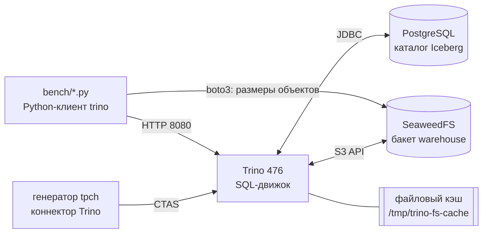

<div align="center">Рисунок 1 – Архитектура локального Lakehouse</div>

| Компонент | Образ | Роль |
|---|---|---|
| Trino | `trinodb/trino:476` | SQL-движок, генератор TPC-H, запись и чтение Iceberg |
| SeaweedFS | `chrislusf/seaweedfs:3.80` | S3-совместимое объектное хранилище, бакет `warehouse` |
| PostgreSQL | `postgres:16-alpine` | JDBC-каталог Iceberg: хранит указатели на актуальный metadata.json |
| create-bucket | `chrislusf/seaweedfs:3.80` | одноразовый контейнер, создает бакет |

<div align="center">Таблица 1 – Компоненты стенда</div>

В Trino настроены два каталога над одними и теми же таблицами: `iceberg` (без файлового кэша) и `iceberg_cached` (с файловым кэшем). Это позволяет сравнивать кэш на одних и тех же файлах.

Фрагмент `docker-compose.yml`:

```yaml
  # s3-совместимое объектное хранилище (minio больше не публикует образы)
  seaweedfs:
    image: chrislusf/seaweedfs:3.80
    command: >
      server -dir=/data -ip=seaweedfs -ip.bind=0.0.0.0
      -s3 -s3.port=8333 -s3.config=/etc/seaweedfs/s3.json
      -master.volumeSizeLimitMB=1024 -volume.max=0

  trino:
    image: trinodb/trino:476
    depends_on:
      postgres:
        condition: service_healthy
      create-bucket:
        condition: service_completed_successfully
    ports:
      - "8080:8080"
    volumes:
      - ./trino/config.properties:/etc/trino/config.properties:ro
      - ./trino/jvm.config:/etc/trino/jvm.config:ro
      - ./trino/catalog:/etc/trino/catalog:ro
    mem_limit: 9g
```

Конфигурация каталога с кэшем `trino/catalog/iceberg_cached.properties`:

```properties
connector.name=iceberg
iceberg.catalog.type=jdbc
iceberg.jdbc-catalog.catalog-name=lakehouse
iceberg.jdbc-catalog.connection-url=jdbc:postgresql://postgres:5432/iceberg_catalog
iceberg.jdbc-catalog.default-warehouse-dir=s3://warehouse/
fs.native-s3.enabled=true
s3.endpoint=http://seaweedfs:8333
s3.path-style-access=true
fs.cache.enabled=true
fs.cache.directories=/tmp/trino-fs-cache
fs.cache.max-sizes=6GB
iceberg.expire-snapshots.min-retention=0s
```

Веб-интерфейс Trino показывает выполненные запросы бенчмарка (рисунок 2), подробности каждого запроса (рисунок 3) и план выполнения по стадиям (рисунок 4).

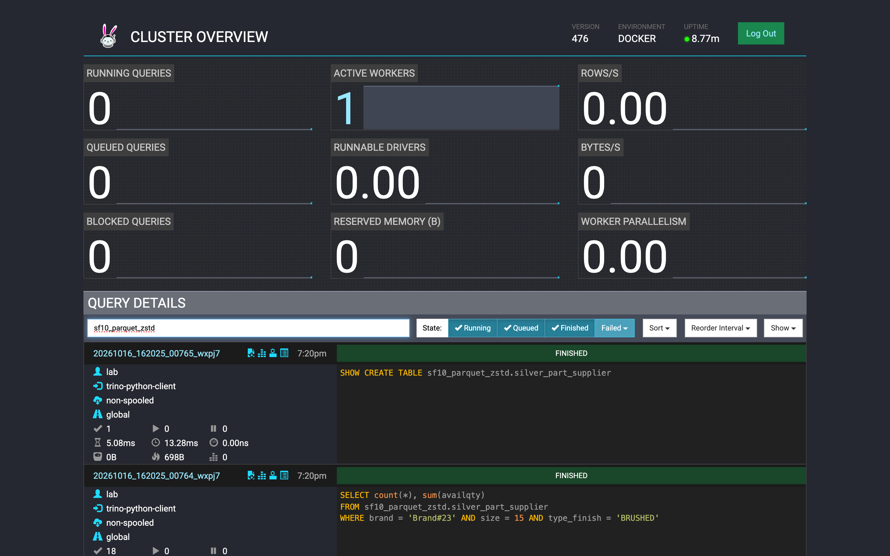

<div align="center">Рисунок 2 – Веб-интерфейс Trino: запросы бенчмарка к схеме sf10_parquet_zstd</div>

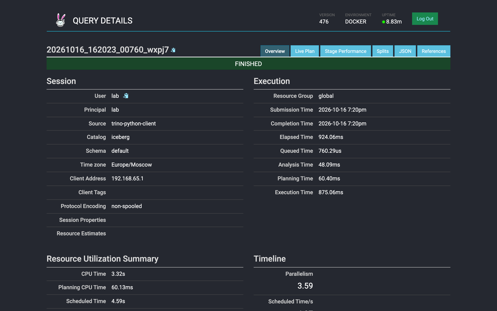

<div align="center">Рисунок 3 – Детали запроса q16_on_bronze: время анализа, планирования и выполнения</div>

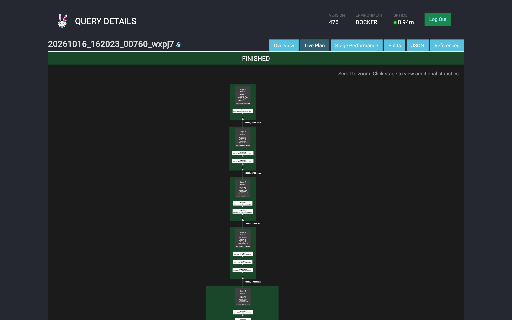

<div align="center">Рисунок 4 – План выполнения Q16 по стадиям в Trino UI</div>

Хранилище SeaweedFS имеет веб-интерфейс файлового менеджера. На рисунке 5 видны таблицы всех слоев одной схемы, на рисунке 6 видна служебная папка `metadata` таблицы Iceberg.

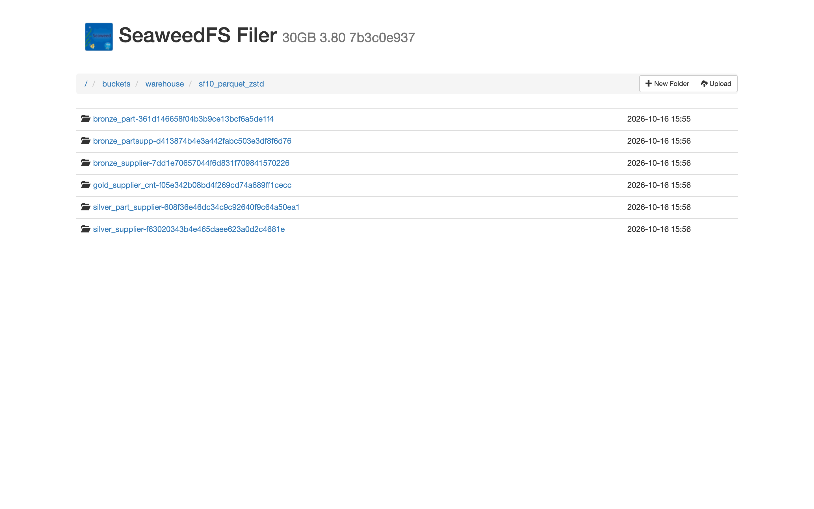

<div align="center">Рисунок 5 – Таблицы слоев bronze, silver, gold в бакете warehouse</div>

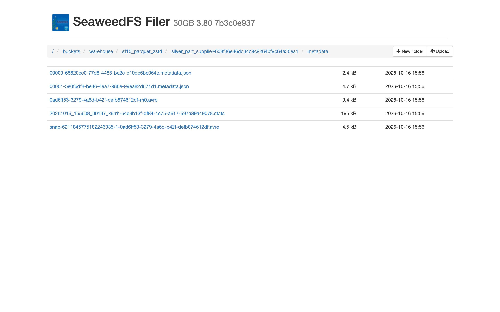

<div align="center">Рисунок 6 – Метаданные Iceberg таблицы silver_part_supplier: metadata.json, manifest list (snap-*.avro), manifest (*-m0.avro), статистика Puffin (*.stats)</div>

### 3.2 Структура проекта

```
lab4-lakehouse-q16/
├── docker-compose.yml          стенд: trino, seaweedfs, postgres
├── postgres/init.sql           служебные таблицы jdbc-каталога iceberg
├── seaweedfs/s3.json           ключи доступа s3
├── trino/
│   ├── config.properties       настройки координатора и памяти
│   ├── jvm.config
│   └── catalog/                tpch, iceberg, iceberg_cached
├── sql/
│   ├── 00_reference_q16.sql    эталонный q16 по генератору
│   ├── 01_bronze.sql           слой bronze
│   ├── 02_silver.sql           слой silver
│   ├── 03_gold.sql             слой gold
│   └── 04_bench_queries.sql    запросы для замеров
├── bench/
│   ├── common.py               подключение, замеры, размеры в s3
│   ├── run_benchmark.py        матрица формат x кодек
│   ├── experiments.py          метаданные и кэширование
│   ├── summary.py              сводные таблицы
│   ├── plots.py                графики
│   └── screenshots.py          скриншоты интерфейсов
├── results/                    сырые замеры csv и сводки md
├── images/                     графики и скриншоты
├── run_all.sh                  полный прогон одной командой
└── README.md                   этот отчет
```

Назначение основных файлов:

- `sql/01_bronze.sql`, `02_silver.sql`, `03_gold.sql` – SQL-шаблоны слоев. Плейсхолдеры `{sf}`, `{schema}`, `{fmt}` подставляются из Python, поэтому один и тот же код строит все варианты;
- `bench/run_benchmark.py` – для каждого сочетания формата и кодека создает свою схему, строит три слоя, замеряет запись, размеры, сверяет gold с эталоном и замеряет запросы;
- `bench/experiments.py` – эксперимент с фрагментацией таблицы и ее обслуживанием, а также эксперимент с файловым кэшем;
- `bench/summary.py`, `bench/plots.py` – превращают CSV в таблицы и графики этого отчета.

### 3.3 Используемые инструменты и технологии

- **Docker Desktop** – изоляция и воспроизводимость стенда одной командой `docker compose up`;
- **Trino 476** – распределенный SQL-движок. Выбран потому, что синтаксис варианта (`tpch.sf1.part`) взят из встроенного коннектора TPC-H Trino, и потому, что Trino пишет Iceberg в Parquet и ORC с выбором кодека через сессионное свойство `iceberg.compression_codec`;
- **Apache Iceberg** – табличный формат над файлами: транзакции, снапшоты, метаданные со статистиками;
- **SeaweedFS** – S3-совместимое объектное хранилище (замена MinIO, см. п. 3.13);
- **PostgreSQL** – JDBC-каталог Iceberg;
- **Python 3.12**: `trino` (клиент и статистика запросов), `boto3` (размеры объектов в S3), `pandas` (обработка результатов), `matplotlib` (графики), `playwright` (скриншоты через установленный Chrome);
- **Visual Studio Code** – разработка.

### 3.4 Выбор масштаба данных

В условии лабораторной указан объем порядка 50 ГБ, а в примечаниях к варианту сказано, что масштаб `sfN` выбирает студент. Выбран основной масштаб **sf10** и контрольный **sf1**. Обоснование:

1. **Диск.** На ноутбуке свободно около 45 ГБ. Бенчмарк хранит одновременно 9 вариантов хранения, в каждом все три слоя. При sf10 несжатый вариант занимает около 1,5 ГиБ, все 9 вариантов вместе около 6,6 ГиБ. При sf50 это было бы около 33 ГиБ только данных плюс тома Docker, и диск бы закончился.
2. **Q16 читает только три таблицы.** sf10 означает около 10 ГБ для всех восьми таблиц TPC-H, но Q16 использует только `part` (2 млн строк), `partsupp` (8 млн строк) и `supplier` (100 тыс. строк), то есть около 1,4 ГБ сырого текста. Этого достаточно, чтобы время запросов измерялось секундами, а не миллисекундами, и различия форматов были видны на фоне шума.
3. **Память.** Docker Desktop выделено около 12 ГБ, Trino получил 7 ГБ кучи. Джойн `partsupp × part` с `count(DISTINCT)` при sf10 гарантированно помещается в память без спилла.
4. **Время.** Полный прогон sf1 + sf10 со всеми экспериментами занимает около 35 минут, что позволяет повторять замеры.
5. **Детерминированность.** Генератор `tpch.sfN` выдает одинаковые строки у всех, поэтому результаты воспроизводимы. sf1 используется как контроль: на нем видно, как меняется доля метаданных при уменьшении данных в 10 раз.

Все слои одного прогона используют один и тот же масштаб.

### 3.5 Реализация слоев bronze, silver, gold

**Bronze** – сырые таблицы переносятся из генератора без изменений, добавляются только служебные поля загрузки:

```sql
-- bronze: сырые таблицы как есть, добавляем только служебные поля загрузки
CREATE TABLE {schema}.bronze_part WITH (format = '{fmt}') AS
SELECT p.*, current_timestamp(3) AS _ingested_at, 'tpch.{sf}.part' AS _source
FROM tpch.{sf}.part AS p;

CREATE TABLE {schema}.bronze_partsupp WITH (format = '{fmt}') AS
SELECT ps.*, current_timestamp(3) AS _ingested_at, 'tpch.{sf}.partsupp' AS _source
FROM tpch.{sf}.partsupp AS ps;
```

**Silver** – два шага. Сначала справочник поставщиков, где сырой текстовый комментарий заменен булевым флагом жалоб. Затем основная таблица: поставки соединяются с деталями, поставщики с жалобами исключаются, строки нормализуются (`trim`, `upper`) и обогащаются производными признаками: тип детали раскладывается на класс, обработку и материал, а для склада считается стоимость запаса.

```sql
-- справочник поставщиков с флагом жалоб вместо сырого комментария
CREATE TABLE {schema}.silver_supplier WITH (format = '{fmt}') AS
SELECT
  suppkey,
  trim(name)                                  AS supplier_name,
  nationkey,
  comment LIKE '%Customer%Complaints%'        AS has_complaints
FROM {schema}.bronze_supplier
WHERE suppkey IS NOT NULL;

-- основная silver таблица: поставка + деталь, без поставщиков с жалобами
CREATE TABLE {schema}.silver_part_supplier WITH (format = '{fmt}') AS
SELECT
  ps.partkey,
  ps.suppkey,
  trim(p.brand)                               AS brand,
  upper(trim(p.type))                         AS type,
  split_part(upper(trim(p.type)), ' ', 1)     AS type_grade,
  split_part(upper(trim(p.type)), ' ', 2)     AS type_finish,
  split_part(upper(trim(p.type)), ' ', 3)     AS type_material,
  p.size,
  p.container,
  p.retailprice,
  ps.availqty,
  ps.supplycost,
  ps.availqty * ps.supplycost                 AS stock_value
FROM {schema}.bronze_partsupp AS ps
JOIN {schema}.bronze_part AS p ON p.partkey = ps.partkey
WHERE ps.partkey IS NOT NULL
  AND ps.suppkey NOT IN (
    SELECT suppkey FROM {schema}.silver_supplier WHERE has_complaints
  );
```

Фильтры по бренду, типу и размеру намеренно не применяются в silver: этот слой переиспользуемый, и другие витрины могут спрашивать про другие бренды. При sf10 жалобы есть у 56 из 100 000 поставщиков, поэтому из 8 000 000 поставок в silver остается 7 995 520.

**Gold** – витрина, которая отвечает на вопрос Q16:

```sql
-- gold: витрина ответа на q16
CREATE TABLE {schema}.gold_supplier_cnt WITH (format = '{fmt}') AS
SELECT
  brand,
  type,
  size,
  count(DISTINCT suppkey) AS supplier_cnt
FROM {schema}.silver_part_supplier
WHERE brand <> 'Brand#45'
  AND type NOT LIKE 'MEDIUM POLISHED%'
  AND size IN (49, 14, 23, 45, 19, 3, 36, 9)
GROUP BY brand, type, size;
```

**Проверка корректности.** Для каждого варианта gold сравнивается построчно с эталонным Q16, выполненным напрямую по генератору `tpch.sf10` (файл `sql/00_reference_q16.sql`). Результат: **9 из 9 вариантов совпали**, 27 840 строк при sf10 и 18 314 строк при sf1. Первые строки витрины:

| brand | type | size | supplier_cnt |
|---|---|---|---|
| Brand#44 | STANDARD PLATED TIN | 9 | 120 |
| Brand#12 | STANDARD POLISHED COPPER | 14 | 100 |
| Brand#11 | LARGE BRUSHED STEEL | 36 | 96 |
| Brand#23 | PROMO BURNISHED STEEL | 14 | 96 |
| Brand#34 | MEDIUM BRUSHED STEEL | 23 | 96 |

<div align="center">Таблица 2 – Фрагмент витрины gold_supplier_cnt (sf10)</div>

### 3.6 Методология бенчмарка

**Матрица вариантов.** 2 формата × 5 кодеков = 10 сочетаний, из них 9 выполнимы: Trino не умеет писать Parquet с LZ4 (`Compression codec LZ4 not supported for Parquet`). Каждый вариант живет в своей схеме, например `sf10_parquet_zstd`, и содержит все шесть таблиц трех слоев. Формат задается свойством таблицы `format`, кодек задается сессионным свойством `iceberg.compression_codec`.

**Что измеряется:**

| Метрика | Источник |
|---|---|
| время записи | `elapsedTimeMillis` каждого `CREATE TABLE AS` |
| процессорное время | `cpuTimeMillis` из статистики запроса Trino |
| размер данных и метаданных | сумма размеров объектов в S3 под префиксами `data/` и `metadata/` таблицы (boto3) |
| время запроса | `elapsedTimeMillis`, отдельно `planningTimeMillis` |
| объем чтения | `physicalInputBytes`, сколько байт реально прочитано из хранилища |

Замер в Python выполняется функцией `run`, она возвращает статистику Trino по каждому запросу:

```python
def run(conn, sql):
    cur = conn.cursor()
    t0 = time.perf_counter()
    cur.execute(sql)
    rows = cur.fetchall()
    wall = time.perf_counter() - t0
    s = cur.stats
    return rows, {
        "query_id": cur.query_id,
        "wall_s": round(wall, 3),
        "elapsed_ms": s.get("elapsedTimeMillis"),
        "cpu_ms": s.get("cpuTimeMillis"),
        "planning_ms": s.get("planningTimeMillis"),
        "analysis_ms": s.get("analysisTimeMillis"),
        "physical_input_bytes": s.get("physicalInputBytes"),
        "processed_rows": s.get("processedRows"),
        "peak_memory_bytes": s.get("peakMemoryBytes"),
    }
```

Построение одного варианта:

```python
def build_variant(sf, fmt, codec):
    schema = schema_name(sf, fmt, codec)
    conn = connect(codec=codec)
    run(conn, f"DROP SCHEMA IF EXISTS {schema} CASCADE")
    run(conn, f"CREATE SCHEMA {schema}")

    writes = []
    for layer, fname in LAYER_FILES:
        for sql in statements(SQL_DIR / fname, sf=sf, schema=schema, fmt=fmt):
            table = re.search(r"CREATE TABLE \S+?\.(\w+)", sql).group(1)
            rows, st = run(conn, sql)
            writes.append({"sf": sf, "format": fmt, "codec": codec, "layer": layer,
                           "table": table, "rows_written": rows[0][0], **st})
    return schema, writes
```

**Запросы-агрегации** (`sql/04_bench_queries.sql`):

| Запрос | Что проверяет |
|---|---|
| `q16_on_bronze` | исходный Q16 по сырому слою: джойн, анти-джойн, `count(DISTINCT)` |
| `q16_on_silver` | тот же ответ по очищенному и уже соединенному слою |
| `gold_read` | чтение готовой витрины, как это делает BI |
| `scan_agg` | широкий скан числовых колонок с группировкой |
| `point_filter` | селективный фильтр, работа статистик min/max |

<div align="center">Таблица 3 – Запросы бенчмарка</div>

**Борьба с шумом.** Ноутбук не изолированный сервер: Docker VM, фоновые процессы и тепловой режим M3 дают разброс. Поэтому:

1. каждый запрос выполняется 1 + 7 раз, нулевой прогон отбрасывается, в отчет идет **медиана**;
2. замеры выполняются **по кругу**: в каждом раунде проходятся все 9 вариантов подряд, и фоновая помеха ложится на все варианты поровну, а не на один. Первый, последовательный проход сохранен в `results/<sf>/queries_sequential.csv` для сравнения;

```python
def bench_round_robin(sf, rounds):
    # раунды по кругу через все варианты, чтобы фоновый шум ложился на всех поровну
    conn = connect()
    plan = [(f, c, schema_name(sf, f, c)) for f, c in variants()]
    out = []
    for i in range(rounds + 1):
        for fmt, codec, schema in plan:
            for name, sql in named_queries(schema=schema).items():
                _, st = run(conn, sql)
                out.append({"sf": sf, "format": fmt, "codec": codec, "query": name, "run": i, **st})
    return out
```

3. в эксперименте с кэшем Trino перезапускается перед каждой серией, а JIT-компилятор прогревается на *другой* схеме, чтобы «холодный» запуск мерил ввод-вывод и метаданные, а не компиляцию байткода.

**Время записи** включает генерацию строк коннектором TPC-H. Генерация одинакова для всех вариантов, поэтому разница между вариантами отражает именно стоимость кодирования, сжатия и выгрузки в S3.

### 3.7 Результаты: размер файлов

| Формат | Кодек | Bronze, МиБ | Silver, МиБ | Gold, КиБ | Всего, МиБ | Сжатие к NONE |
|---|---|---|---|---|---|---|
| Parquet | NONE | 1245,1 | 230,6 | 80,0 | 1475,8 | 1,00 |
| Parquet | SNAPPY | 462,2 | 172,9 | 77,2 | 635,2 | 2,32 |
| Parquet | ZSTD | 324,3 | 122,6 | 71,0 | 446,9 | 3,30 |
| Parquet | GZIP | 294,8 | 119,0 | 70,1 | **413,9** | **3,57** |
| ORC | NONE | 1245,4 | 255,7 | 114,0 | 1501,2 | 1,00 |
| ORC | SNAPPY | 446,1 | 163,5 | 104,9 | 609,7 | 2,46 |
| ORC | LZ4 | 497,4 | 164,7 | 103,0 | 662,1 | 2,27 |
| ORC | ZSTD | 313,5 | 115,4 | 69,7 | 428,9 | 3,50 |
| ORC | GZIP | 300,7 | 114,1 | 72,6 | **414,9** | **3,62** |

<div align="center">Таблица 4 – Размер данных по слоям (sf10)</div>

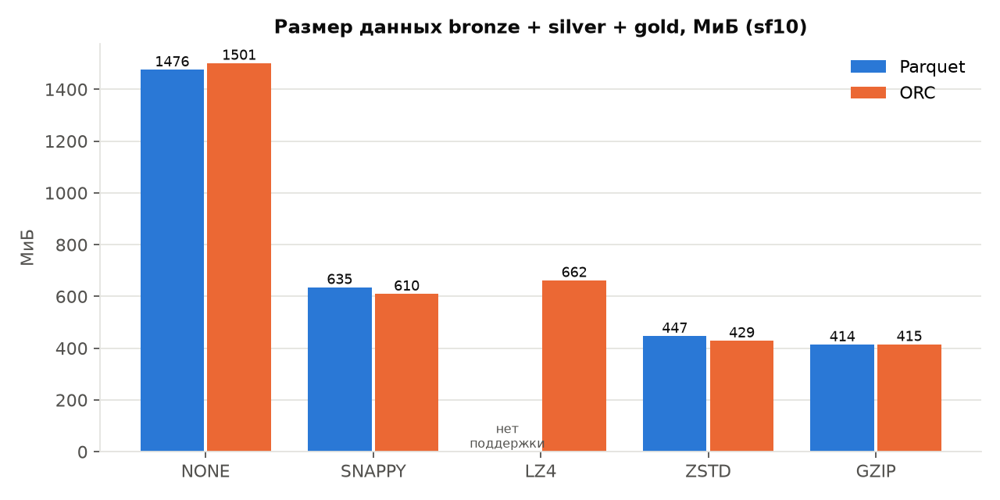

<div align="center">Рисунок 7 – Суммарный размер всех слоев по кодекам (sf10)</div>

Выводы:

- сжатие уменьшает данные в **2,3–3,6 раза**. GZIP сжимает сильнее всех, ZSTD отстает от него всего на 3–8 %, SNAPPY и LZ4 дают примерно в полтора раза больший размер;
- без сжатия Parquet и ORC практически равны: 1,25 ГиБ bronze, это и есть объем сырого текста TPC-H для трех таблиц;
- со сжатием ORC немного компактнее Parquet на SNAPPY и ZSTD. Вероятная причина – встроенное в ORC легкое кодирование целых чисел (RLE v2) и более крупные stripes;
- основную часть объема занимает bronze, а внутри него колонка `comment` таблицы `partsupp` (случайный текст около 120 символов). Silver после удаления комментариев меньше bronze в 2,6–5,4 раза, а gold весит десятки килобайт.

**Метаданные.** У каждого варианта метаданные Iceberg занимают около 834 КиБ на 6 таблиц, и от кодека они почти не зависят. Основная их часть – файлы статистики Puffin (около 195 КиБ на большую таблицу). При sf1 это **1,78 %** от объема данных Parquet+ZSTD, при sf10 только **0,18 %**. Размер метаданных постоянен, данные растут линейно, поэтому на малых таблицах доля метаданных заметна, а на больших почти исчезает.

### 3.8 Результаты: время записи

| Формат | Кодек | Bronze, с | Silver, с | Gold, с | Всего, с | CPU, с |
|---|---|---|---|---|---|---|
| Parquet | NONE | 36,52 | 18,27 | 1,22 | 56,00 | 147,3 |
| Parquet | SNAPPY | 21,66 | 18,06 | 1,52 | **41,24** | 157,4 |
| Parquet | ZSTD | 23,26 | 18,37 | 1,03 | 42,65 | 171,2 |
| Parquet | GZIP | 26,96 | 16,36 | 0,62 | 43,94 | 175,6 |
| ORC | NONE | 36,96 | 15,38 | 0,88 | 53,22 | 146,3 |
| ORC | SNAPPY | 25,54 | 15,86 | 1,04 | 42,45 | 140,3 |
| ORC | LZ4 | 25,55 | 15,42 | 1,30 | 42,27 | **135,3** |
| ORC | ZSTD | 22,78 | 21,02 | 1,23 | 45,04 | 155,4 |
| ORC | GZIP | 33,20 | 21,16 | 1,53 | 55,89 | 198,4 |

<div align="center">Таблица 5 – Время записи слоев (sf10)</div>

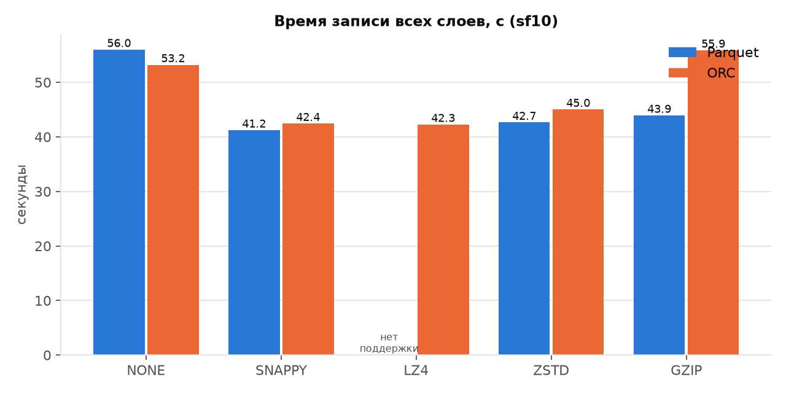

<div align="center">Рисунок 8 – Суммарное время записи всех слоев (sf10)</div>

Выводы:

- **запись без сжатия самая медленная** (53–56 с), хотя процессор на сжатие не тратится. Узкое место здесь – выгрузка 1,5 ГиБ в S3, а не CPU. Сжатие уменьшает объем выгрузки в 2–3,5 раза, и это перевешивает затраты на кодек;
- **GZIP самый дорогой по процессору**: для ORC 198 с CPU против 135 с у LZ4, то есть на 47 % больше. По общему времени ORC+GZIP так же медленен, как запись без сжатия;
- SNAPPY, LZ4 и ZSTD пишут примерно одинаково быстро (41–45 с). ZSTD тратит на 9–11 % больше CPU, чем SNAPPY, но дает на 30 % меньший размер.

### 3.9 Результаты: скорость агрегаций

Медиана 7 повторных запусков при замерах по кругу, мс:

| Формат | Кодек | q16_on_bronze | q16_on_silver | gold_read | scan_agg | point_filter | Прочитано q16_on_bronze, МиБ |
|---|---|---|---|---|---|---|---|
| Parquet | NONE | 1630 | 1131 | 124 | 228 | 239 | 110,8 |
| Parquet | SNAPPY | 1219 | 976 | 125 | 305 | 348 | 53,1 |
| Parquet | ZSTD | 1292 | 864 | 130 | 303 | 110 | **32,4** |
| Parquet | GZIP | 1325 | 918 | 161 | 411 | 181 | 36,4 |
| ORC | NONE | 1991 | 1102 | 165 | 335 | 182 | 54,3 |
| ORC | SNAPPY | 1281 | 957 | 159 | 302 | 175 | 65,1 |
| ORC | LZ4 | 1291 | 845 | 148 | 259 | 197 | 60,0 |
| ORC | ZSTD | 1263 | **811** | 135 | 260 | 142 | 55,6 |
| ORC | GZIP | **1208** | 939 | 139 | 406 | 182 | 50,7 |

<div align="center">Таблица 6 – Время агрегаций (sf10)</div>

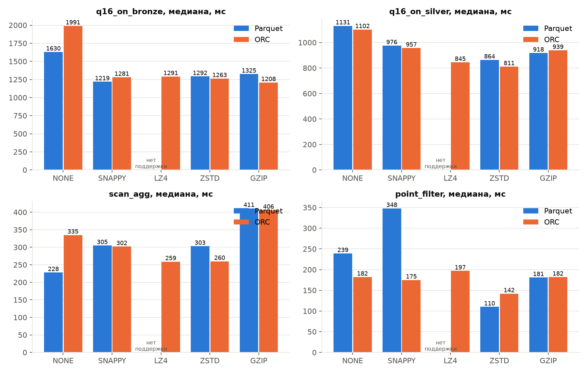

<div align="center">Рисунок 9 – Время запросов по форматам и кодекам (sf10)</div>

Выводы:

1. **Медальонная архитектура окупается сильнее, чем выбор кодека.** Один и тот же ответ Q16 по bronze считается 1,2–2,0 с, по silver 0,8–1,1 с, а чтение gold занимает 0,12–0,17 с, то есть **в 8–13 раз быстрее**. Эталонный Q16 прямо по генератору выполняется 5,5 с.
2. **Без сжатия читать медленнее всего**: Q16 по bronze 1,63 с (Parquet) и 1,99 с (ORC) против 1,2–1,3 с со сжатием. Parquet без сжатия прочитал 110,8 МиБ против 32,4 МиБ у Parquet+ZSTD. При локальном хранилище сжатые варианты быстрее на 25–65 %, в облаке с сетевым S3 разница будет больше.
3. **Между сжатыми вариантами разброс около 10 %**, и он сопоставим с шумом измерений. Порядок кодеков меняется от запроса к запросу. Однозначного «самого быстрого» кодека для чтения нет, есть однозначно худший вариант – NONE.
4. **Parquet читает избирательнее.** На Q16 Parquet+ZSTD прочитал из хранилища 32 МиБ, а ORC+ZSTD 56 МиБ. Вероятно, ридер Parquet в Trino точнее применяет динамическую фильтрацию джойна и пропускает ненужные страницы.
5. **GZIP проигрывает на широком скане** (`scan_agg` 406–411 мс против 228–305 мс у остальных): распаковка DEFLATE медленнее ZSTD, и на запросе, который читает много значений, это становится заметно.
6. `point_filter` по Parquet+ZSTD самый быстрый (110 мс). Данные silver не отсортированы по бренду, поэтому min/max почти ничего не отсекают, и выигрыш дает в основном меньший объем чтения.

### 3.10 Влияние объема метаданных

**Постановка эксперимента.** Из silver-таблицы (Parquet+ZSTD и ORC+ZSTD) строятся две копии: `silver_compact` одним `CREATE TABLE AS` и `silver_fragmented` из 100 последовательных `INSERT`, как при потоковой или микро-батчевой загрузке. Затем на фрагментированной таблице по очереди выполняются процедуры обслуживания, и после каждой снимаются метрики.

```python
    # имитируем потоковую загрузку: много мелких коммитов
    for i in range(batches):
        run(conn, f"INSERT INTO {frag} SELECT * FROM {src} WHERE partkey % {batches} = {i}")

    states = [("compact", compact, None), ("fragmented", frag, None),
              ("after_optimize", frag, f"ALTER TABLE {frag} EXECUTE optimize"),
              ("after_expire", frag, f"ALTER TABLE {frag} EXECUTE expire_snapshots(retention_threshold => '0s')"),
              ("after_manifests", frag, f"ALTER TABLE {frag} EXECUTE optimize_manifests")]
```

| Состояние | Снапшоты | Файлы данных | Файлы метаданных | Метаданные, КиБ | Данные, МиБ | Планирование, мс | q16_on_silver, мс | point_filter, мс |
|---|---|---|---|---|---|---|---|---|
| compact | 1 | 9 | 5 | 211 | 119,8 | 22 | 732 | 95 |
| fragmented | 101 | 100 | 502 | **52 916** | 153,0 | 21 | 652 | **194** |
| после optimize | 102 | 101 | 508 | 53 764 | **272,3** | **50** | **1318** | 149 |
| после expire_snapshots | 1 | 1 | 105 | 24 356 | 119,3 | 28 | 829 | 140 |
| после optimize_manifests | 2 | 1 | 108 | 24 393 | 119,3 | 18 | 887 | 115 |

<div align="center">Таблица 7 – Эксперимент с метаданными, Parquet + ZSTD (sf10)</div>

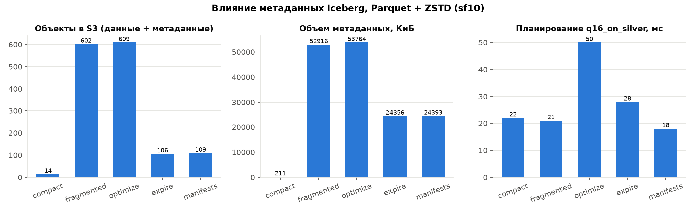

<div align="center">Рисунок 10 – Число объектов, объем метаданных и время планирования по состояниям таблицы (sf10)</div>

Выводы:

- **100 мелких коммитов раздули метаданные в 250 раз**: с 211 КиБ до 52 МиБ. Метаданные составили 35 % от объема самих данных, а при sf1 метаданные (52 МиБ) оказались **в 3,5 раза больше данных** (15 МиБ). Каждый коммит пишет новый metadata.json со всей историей снапшотов, новый manifest list, манифест и файл статистики. Файлов метаданных стало 502 против 5.
- Мелкие файлы данных хуже сжимаются (153 МиБ против 120 МиБ, +28 %), так как словари и статистики строятся по меньшим блокам. Селективный `point_filter` замедлился вдвое (194 мс против 95 мс): нужно открыть 100 файлов и прочитать 100 footer.
- **`optimize` без `expire_snapshots` делает только хуже**: компакция пишет новый крупный файл, но старые 100 файлов остаются в истории снапшотов. Данные удваиваются (272 МиБ), планирование и запрос замедляются в 1,8–2,3 раза. Компакцию нужно всегда выполнять в паре с удалением старых снапшотов.
- **`expire_snapshots` вернул данные к исходному объему, но не метаданные**: осталось 24 МиБ и 105 файлов. Это история `metadata.json`: Iceberg по умолчанию хранит до 100 предыдущих версий (`write.metadata.previous-versions-max`), и каждая следующая версия больше предыдущей. Для таблиц с частыми коммитами это свойство нужно уменьшать или включать `write.metadata.delete-after-commit.enabled`.
- После `optimize_manifests` время планирования вернулось к уровню компактной таблицы (18 мс против 22 мс).
- Время планирования в абсолютных цифрах мало (десятки миллисекунд), потому что хранилище локальное и задержка одного GET меньше миллисекунды. В облачном S3 одно обращение стоит 20–50 мс, и 500 файлов метаданных превращаются в секунды планирования плюс оплату каждого запроса к S3.

### 3.11 Влияние кэширования

**Постановка эксперимента.** Для трех вариантов (Parquet+ZSTD, ORC+ZSTD, Parquet+NONE) каждая серия запускается с холодного старта: файловый кэш удаляется, Trino перезапускается, затем JIT прогревается на другой схеме. После этого выполняется первый запуск и 5 повторных. Серия выполняется дважды: через каталог `iceberg` без кэша и через каталог `iceberg_cached` с файловым кэшем.

```python
        for catalog in ["iceberg", "iceberg_cached"]:
            restart_trino()
            conn = connect(catalog=catalog)
            # прогрев jit на другой схеме, чтобы холодный прогон мерил только io и метаданные
            for warm_fmt in ["PARQUET", "ORC"]:
                warm_q = named_queries(schema=schema_name(sf, warm_fmt, "SNAPPY"))
                for name in CACHE_QUERIES:
                    run(connect(), warm_q[name])
```

| Вариант | Запрос | Без кэша: первый | Без кэша: повторные | С кэшем: первый | С кэшем: повторные | Размер кэша, МиБ |
|---|---|---|---|---|---|---|
| Parquet+ZSTD | q16_on_bronze | 1596 | 1516 | 1955 | **1245** | 154 |
| Parquet+ZSTD | scan_agg | 295 | 249 | 617 | 309 | 154 |
| ORC+ZSTD | q16_on_bronze | 1581 | 1219 | 1483 | **1033** | 179 |
| ORC+ZSTD | scan_agg | 463 | 301 | 274 | 201 | 179 |
| Parquet+NONE | q16_on_bronze | 2077 | 1394 | 1910 | **1220** | 293 |
| Parquet+NONE | scan_agg | 405 | 260 | 721 | 294 | 293 |

<div align="center">Таблица 8 – Эксперимент с кэшированием, мс (sf10)</div>

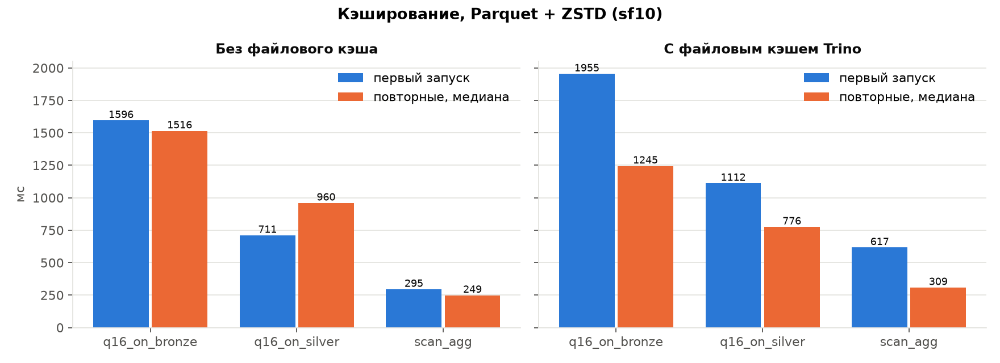

<div align="center">Рисунок 11 – Первый и повторные запуски без файлового кэша и с ним, Parquet + ZSTD (sf10)</div>

Выводы:

- **Файловый кэш ускорил повторный тяжелый Q16 на 12–18 %** во всех трех вариантах (1516 → 1245, 1219 → 1033, 1394 → 1220 мс).
- **Первый запуск с кэшем часто медленнее**, чем без него (до +22 % на Q16, до двух раз на коротком `scan_agg`): данные не только читаются, но и записываются на локальный диск кэша. Кэш окупается только при повторных чтениях одних и тех же файлов.
- **Сжатие и кэш усиливают друг друга.** Одни и те же данные занимают в кэше 154 МиБ при ZSTD и 293 МиБ без сжатия, поэтому в кэш фиксированного размера помещается почти в 2 раза больше «горячих» таблиц.
- **Кэш метаданных JVM** виден по времени планирования: первый запрос после рестарта планируется 103–116 мс, повторные 76–91 мс. Этот кэш работает всегда, даже без файлового.
- На локальном стенде выигрыш от файлового кэша скромный, потому что SeaweedFS отвечает с локального SSD почти так же быстро, как кэш. Короткие запросы на сотни миллисекунд находятся в пределах шума. В облаке, где каждое обращение к S3 идет по сети и тарифицируется, эффект кэша будет кратно больше.

### 3.12 Компромисс «размер ↔ скорость ↔ стоимость»

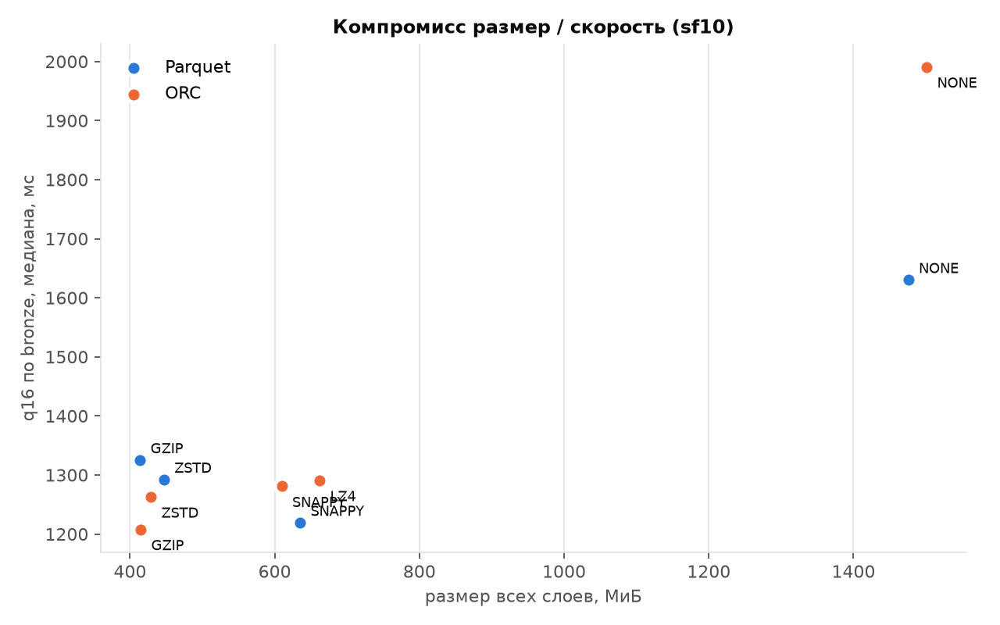

<div align="center">Рисунок 12 – Размер всех слоев и время Q16 по bronze для каждого варианта (sf10)</div>

На рисунке 12 лучшие варианты находятся в левом нижнем углу: маленький размер и быстрый запрос. Без сжатия варианты оказываются в правом верхнем углу, то есть проигрывают сразу по двум осям. ZSTD и GZIP сгруппированы слева, SNAPPY и LZ4 – посередине.

**Модель стоимости.** Для перевода в деньги используется упрощенная модель облачного тарифа: хранение $0,023 за ГБ в месяц (S3 Standard), вычисления $0,04 за vCPU-час, нагрузка 1000 запусков Q16 по bronze в сутки. Процессорное время берется из статистики Trino.

| Формат | Кодек | Хранение, $/мес | Вычисления, $/мес | Итого, $/мес |
|---|---|---|---|---|
| Parquet | NONE | 0,0356 | 1,5547 | 1,5903 |
| Parquet | SNAPPY | 0,0153 | 1,2013 | **1,2167** |
| Parquet | ZSTD | 0,0108 | 1,3140 | 1,3248 |
| Parquet | GZIP | 0,0100 | 1,5457 | 1,5556 |
| ORC | NONE | 0,0362 | 1,6937 | 1,7299 |
| ORC | SNAPPY | 0,0147 | 1,4693 | 1,4840 |
| ORC | LZ4 | 0,0160 | 1,3387 | 1,3546 |
| ORC | ZSTD | 0,0103 | 1,2697 | 1,2800 |
| ORC | GZIP | 0,0100 | 1,2610 | 1,2710 |

<div align="center">Таблица 9 – Оценка месячной стоимости (sf10)</div>

Выводы:

- **При частых запросах стоимость определяют вычисления, а не хранение**: процессор обходится в 40–150 раз дороже диска. Экономия 1 ГБ хранения стоит $0,02 в месяц, а лишние 10 % CPU на каждом запросе стоят в десятки раз больше.
- Если линейно экстраполировать на объем из условия (около 50 ГБ TPC-H, sf50, в 5 раз больше), хранение всех слоев обойдется примерно в $0,18/мес без сжатия против $0,05/мес с ZSTD, а вычисления примерно в $6–8,5/мес. Соотношение не меняется.
- **Хранение решает, когда данные читают редко** (архив, bronze, который перечитывают только при пересчете): там выгоднее всего GZIP или ZSTD, так как они дают максимальное сжатие.
- **Без сжатия хуже по всем трем осям**: самый большой размер, самая долгая запись и самые медленные запросы.

**Рекомендации по слоям:**

| Слой | Рекомендация | Почему |
|---|---|---|
| Bronze | ZSTD (или GZIP для холодного архива) | самый большой слой, читается редко, важна экономия места и ввода-вывода |
| Silver | Parquet + ZSTD | минимальный объем чтения (32 МиБ на Q16), хороший баланс CPU и размера, регулярное обслуживание `optimize` + `expire_snapshots` |
| Gold | Parquet + ZSTD или SNAPPY | таблица маленькая, кодек почти не влияет, важнее совместимость с BI-инструментами |
| Потоковая загрузка | SNAPPY или LZ4 (ORC) | минимум CPU на запись, но обязательно периодическая компакция |

### 3.13 Выявленные проблемы и их решения

1. **Образы MinIO недоступны.** В 2025 году MinIO перестал публиковать образы в Docker Hub и quay.io, и `docker pull minio/minio` возвращает отказ в доступе. Решение: S3-совместимое хранилище SeaweedFS, которое работает с нативным S3-клиентом Trino без изменений, если указать `s3.path-style-access=true`.
2. **JDBC-каталог Iceberg не создавал служебные таблицы** (ошибка `Cannot check and eventually update SQL schema`). Решение: скрипт `postgres/init.sql` создает таблицы `iceberg_tables` и `iceberg_namespace_properties` при первом старте Postgres.
3. **Parquet + LZ4 не поддерживается Trino.** Сочетание исключено из матрицы, это отражено на графиках подписью «нет поддержки».
4. **Холодный запуск после рестарта измерял JIT, а не ввод-вывод.** Первый запрос после перезапуска Trino был в 4 раза медленнее из-за компиляции байткода. Решение: прогрев на другой схеме перед каждой серией.
5. **Шум последовательных замеров.** При последовательном проходе (`queries_sequential.csv`) один вариант мог случайно попасть на фоновую нагрузку, например ORC+ZSTD получил 1659 мс на Q16 вместо 1263 мс. Решение: замеры по кругу через все варианты, 7 раундов, медиана.
6. **Метаданные не уменьшались после `expire_snapshots`.** Причина – хранение истории metadata.json (п. 3.10). Это оставлено как результат эксперимента и описано в выводах.
7. **Ограничение диска для объема 50 ГБ.** Решение: масштаб sf10 с обоснованием (п. 3.4) и экстраполяция стоимости на sf50 (п. 3.12).

### 3.14 Инструкция по запуску

Требования: Docker Desktop (около 12 ГБ памяти для Docker), Python 3.10+, около 15 ГБ свободного места, Google Chrome (только для скриншотов).

```bash
# 1. стенд
docker compose up -d --wait

# 2. окружение python
python3 -m venv .venv
.venv/bin/pip install -r requirements.txt

# 3. полный прогон: слои, бенчмарк, эксперименты, графики
./run_all.sh                        # sf1 и sf10, около 35 минут
SF_LIST=sf1 ./run_all.sh            # быстрая проверка, около 7 минут

# отдельные шаги
.venv/bin/python bench/run_benchmark.py --sf sf10 --repeats 5
.venv/bin/python bench/run_benchmark.py --sf sf10 --repeats 7 --queries-only
.venv/bin/python bench/experiments.py metadata --sf sf10
.venv/bin/python bench/experiments.py cache --sf sf10
.venv/bin/python bench/summary.py sf10 > results/summary_sf10.md
.venv/bin/python bench/plots.py
.venv/bin/python bench/screenshots.py sf10

# 4. остановить стенд и удалить данные
docker compose down -v
```

Интерфейсы: Trino UI – http://localhost:8080/ui/, файловый менеджер SeaweedFS – http://localhost:8888/buckets/warehouse/. Подключиться к Trino из консоли можно командой `docker compose exec trino trino`.

Сырые результаты лежат в `results/sf1/` и `results/sf10/` (CSV), сводные таблицы – в `results/summary_sf1.md` и `results/summary_sf10.md`.

---

## ЗАКЛЮЧЕНИЕ

В ходе лабораторной работы развернут локальный Lakehouse из Trino, Apache Iceberg, S3-совместимого хранилища SeaweedFS и каталога на PostgreSQL. Для варианта 4 (TPC-H Q16) реализован полный цикл обработки: сырые данные загружены в bronze, в silver они очищены, нормализованы, обогащены и избавлены от поставщиков с жалобами, а в gold построена витрина `brand, type, size, supplier_cnt`. Во всех 9 вариантах хранения витрина совпала с эталонным результатом запроса.

Бенчмарк форматов Parquet и ORC с кодеками NONE, SNAPPY, LZ4, ZSTD и GZIP на масштабе sf10 показал следующее:

- сжатие уменьшает данные в 2,3–3,6 раза. Лучшая степень сжатия у GZIP, ZSTD отстает от него всего на 3–8 %;
- без сжатия хуже по всем трем осям: самый большой размер, самая долгая запись (выгрузка в S3 дороже работы кодека) и самые медленные запросы;
- GZIP самый дорогой по процессору при записи (+47 % CPU) и медленнее остальных на широких сканах. ZSTD дает почти такое же сжатие при заметно меньших затратах;
- разница в скорости между сжатыми вариантами около 10 %, а переход от bronze к готовой витрине gold ускоряет ответ в 8–13 раз. Медальонная архитектура влияет на скорость сильнее, чем выбор кодека;
- 100 мелких коммитов раздувают метаданные Iceberg в 250 раз и вдвое замедляют селективные запросы. Компакция без удаления старых снапшотов удваивает объем данных, поэтому таблицы нужно обслуживать связкой `optimize` + `expire_snapshots` + `optimize_manifests`;
- файловый кэш Trino ускоряет повторные тяжелые запросы на 12–18 %, но замедляет первый запуск. Сжатие позволяет держать в кэше почти вдвое больше данных;
- при регулярных запросах стоимость определяют вычисления, а не хранение, поэтому для горячих слоев нужно выбирать кодек по затратам CPU на чтение, а для холодных – по степени сжатия.

Практический итог: для аналитических слоев оптимален **Parquet + ZSTD**, для холодного архива подходит GZIP или ZSTD, для потоковой записи – легкий кодек с регулярной компакцией. Поставленная цель достигнута, все задачи выполнены.

---

## СПИСОК ЛИТЕРАТУРЫ

1. TPC Benchmark H (Decision Support) Standard Specification. Revision 3.0.1 / Transaction Processing Performance Council. — 2022. — 138 p.
2. Armbrust, M. Lakehouse: A New Generation of Open Platforms that Unify Data Warehousing and Advanced Analytics / M. Armbrust, A. Ghodsi, R. Xin, M. Zaharia // CIDR. — 2021.
3. Клеппман, М. Высоконагруженные приложения. Программирование, масштабирование, поддержка / М. Клеппман. — Санкт-Петербург : Питер, 2018. — 640 с.
4. Fuller, M. Trino: The Definitive Guide / M. Fuller, M. Moser, M. Traverso. — 2nd ed. — O'Reilly Media, 2023. — 386 p.
5. Shiran, T. Apache Iceberg: The Definitive Guide / T. Shiran, J. Hughes, A. Merced. — O'Reilly Media, 2024. — 344 p.
6. Apache Parquet Documentation [Электронный ресурс]. — URL: https://parquet.apache.org/docs/ (дата обращения: 16.10.2026).
7. Apache ORC Specification v1 [Электронный ресурс]. — URL: https://orc.apache.org/specification/ORCv1/ (дата обращения: 16.10.2026).
8. Apache Iceberg Table Spec [Электронный ресурс]. — URL: https://iceberg.apache.org/spec/ (дата обращения: 16.10.2026).
9. Trino Documentation. Iceberg connector [Электронный ресурс]. — URL: https://trino.io/docs/current/connector/iceberg.html (дата обращения: 16.10.2026).
10. Trino Documentation. File system cache [Электронный ресурс]. — URL: https://trino.io/docs/current/object-storage/file-system-cache.html (дата обращения: 16.10.2026).
11. Collet, Y. Zstandard Compression and the application/zstd Media Type. RFC 8878 / Y. Collet, M. Kucherawy. — IETF, 2021.
12. SeaweedFS Wiki. Amazon S3 API [Электронный ресурс]. — URL: https://github.com/seaweedfs/seaweedfs/wiki/Amazon-S3-API (дата обращения: 16.10.2026).
